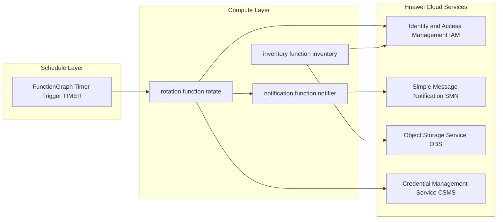

# IAM Access Key Auto Rotation

[](LICENSE)
[](https://support.huaweicloud.com/intl/en-us/)
[](#)

> IAM Access Key lifecycle automation on Huawei Cloud

---

## Overview

This reference architecture automates the lifecycle of IAM user access keys on Huawei Cloud — creating, disabling, and deleting them on a schedule — to reduce the risk of long-lived static credentials. It targets security operations, DevOps, and compliance teams and serves as a production-ready credential governance template.

### Key Features

- **Periodic rotation**: generates a new access key for the designated IAM user on a schedule (default 90 days).
- **Graceful degradation**: over-age keys are first disabled (default day 100), then deleted (default day 110) to avoid service interruption.
- **Proactive notification**: key actions are pushed via the Simple Message Notification (SMN) email subscription; the key plaintext is disclosed only once at creation.
- **One-click deployment**: Terraform provisions the FunctionGraph workflows, triggers, notification topic, and storage bucket.

---

## Architecture

> A daily timer wakes the rotation function, which runs the closed loop: list users → evaluate key age → create/disable/delete keys → push notification.



**Key components**:
- **rotation function rotate**: core logic deciding create/disable/delete based on key creation time.
- **inventory function inventory**: periodically lists IAM users under the account and outputs a user list for rotation reference.
- **notification function notifier**: wraps the rotation result into an email body and publishes it to the SMN topic.
- **timer trigger TIMER**: fires the rotation function once a day via a Cron expression.

---

## Cloud Services

| Service | Purpose | Notes |
|---|---|---|
| Identity and Access Management (IAM) | Create, disable, delete user access keys | Credential governance core |
| FunctionGraph | Hosts the three serverless functions and timer triggers | Event-driven execution |
| Object Storage Service (OBS) | Stores function deployment packages and notification templates | Code hosting |
| Simple Message Notification (SMN) | Pushes rotation events to subscribers (email) | Proactive notification |
| Credential Management Service (CSMS) | Optional: stores the latest key plaintext for later retrieval | Secret storage |

---

## Prerequisites

| Item | Requirement | Description |
|---|---|---|
| Account | Huawei Cloud account with real-name verification | Personal or enterprise |
| Permissions | IAM **Security Administrator** plus FunctionGraph / SMN / OBS permissions | To create functions, topics, and access keys |
| Region | `cn-north-4` recommended | Functions and storage must be in the same region |
| Terraform | `>= 1.5.0` | Infrastructure-as-code deployment tool |
| huaweicloud Provider | `>= 1.97.0` | Huawei Cloud Terraform provider |
| Python | `>= 3.9` | Local static checks and packaging |
| Access Key | Access key created and placed into the deployment script | Do not write credentials into any code or configuration file |

> **Prepare the access key**:
> ```bash
> export HW_ACCESS_KEY="<your-access-key>"
> export HW_SECRET_KEY="<your-secret-key>"
> ```
> Obtain the Access Key and Secret Access Key from the Huawei Cloud "My Credentials" page and place them into the deployment script. All `.tf` / documents use placeholders and never contain real credentials.

---

## Quick Start

```bash
# 1. Clone the repository
git clone <repository HTTPS URL> <repository root>
cd <repository root>

# 2. Configure the access key (see Prerequisites)
export HW_ACCESS_KEY="<your-access-key>"
export HW_SECRET_KEY="<your-secret-key>"

# 3. Build function packages and deploy
cd infra
terraform init
terraform plan
terraform apply -auto-approve
```

---

## Deployment

### Step 1: Build function packages

```bash
cd <repository root>
bash infra/build.sh
```

Expected output: `rotate.zip`, `inventory.zip`, `notifier.zip` generated under `infra/build/`.

### Step 2: Initialize the working directory

```bash
cd <repository root>/infra
terraform init
```

Expected output: `Terraform has been successfully initialized!`

### Step 3: Preview resource changes

```bash
terraform plan
```

Expected output: `Plan: N to add, 0 to change, 0 to destroy.`

### Step 4: Apply

```bash
terraform apply -auto-approve
```

Expected output: `Apply complete! Resources: N added, 0 changed, 0 destroyed.`

### Step 5: Record key outputs

```bash
terraform output
```

Expected output: function URNs, SMN topic URN, OBS bucket name, etc.

---

## Usage

### Verification 1: Static source check

```bash
cd <repository root>
python -m py_compile src/functions/rotate/index.py \
                   src/functions/inventory/index.py \
                   src/functions/notifier/index.py \
                   src/common/*.py
```

### Verification 2: Local rotation-decision walkthrough

```bash
cd <repository root>
python src/functions/rotate/selftest.py
```

### Verification 3: Infrastructure syntax check

```bash
cd <repository root>/infra
terraform validate
```

### Verification 4: End-to-end in the cloud (run by the user after deployment)

Manually trigger the rotation function (via the FunctionGraph console or CLI) and observe whether the SMN email notification is delivered.

---

## Cleanup

```bash
cd <repository root>/infra
terraform destroy -auto-approve
```

---

## License

This practice is released under the **MIT No Attribution** license. See the [`LICENSE`](LICENSE) file at the repository root.

---

## Contact

| Item | Content |
|---|---|
| **Creator** | zhangcheng123321 |
| **Maintainer** | zhangcheng123321 |
| **Team** | zhangcheng123321 |
| **Feedback** | Submit an Issue / PR |
