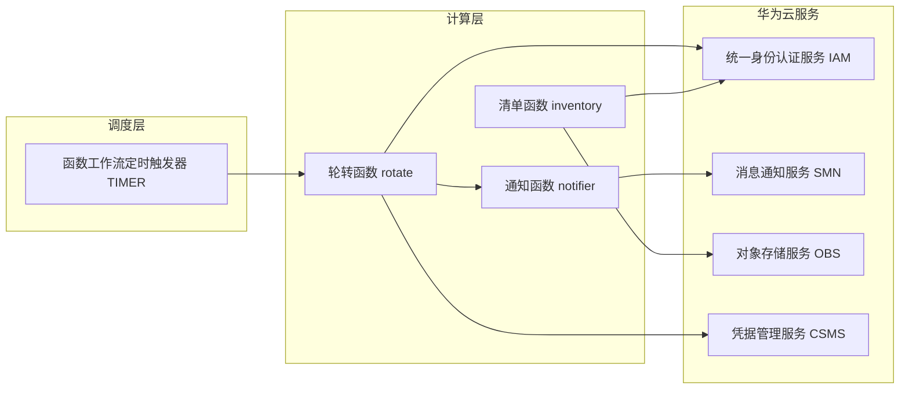

# IAM 访问密钥自动轮转 / IAM Access Key Auto Rotation

[](LICENSE)
[](https://support.huaweicloud.com/intl/en-us/)
[](#)

> 面向统一身份认证服务（IAM）的访问密钥生命周期自动化实践
> IAM Access Key lifecycle automation on Huawei Cloud

---

## 1. 简介 / Overview [CRITICAL]

**中文**：本实践提供一套自动化机制，用于管理华为云 IAM 用户访问密钥（Access Key）的创建、禁用与删除，降低长期暴露的静态凭据带来的安全风险。面向安全运维、DevOps 与合规审计人员，可作为生产环境的凭据治理模板使用。

**English**: This reference architecture automates the lifecycle of IAM user access keys on Huawei Cloud — creating, disabling, and deleting them on a schedule — to reduce the risk of long-lived static credentials. It targets security operations, DevOps, and compliance teams and serves as a production-ready credential governance template.

### 核心能力

- **周期性轮转**：按设定周期（默认 90 天）为指定 IAM 用户生成新的访问密钥
- **平滑降级**：超期密钥先禁用（默认第 100 天），再彻底删除（默认第 110 天），避免业务中断
- **主动通知**：关键动作通过消息通知服务（SMN）邮件订阅推送，密钥明文仅在创建时一次性披露
- **一键部署**：通过基础设施即代码（Terraform）完成函数工作流、触发器、通知主题与存储桶的创建

---

## 2. 目录 [MINOR]

- [1. 简介](#1-简介--overview-critical)
- [2. 目录](#2-目录-minor)
- [3. 架构图](#3-架构图-minor)
- [4. 方案亮点](#4-方案亮点-minor)
- [5. 涉及云服务](#5-涉及云服务-minor)
- [6. 前置条件](#6-前置条件-critical)
- [7. 快速开始](#7-快速开始-critical)
- [8. 分步部署](#8-分步部署-minor)
- [9. 使用方法 / 验证](#9-使用方法--验证-critical)
- [10. 清理资源](#10-清理资源-minor)
- [11. 详细说明](#11-详细说明-minor)
- [12. 依赖](#12-依赖-minor)
- [13. FAQ / 故障排除](#13-faq--故障排除-minor)
- [14. 贡献指南](#14-贡献指南-minor)
- [15. 许可证](#15-许可证-critical)
- [16. 联系方式 / 维护者](#16-联系方式--维护者-critical)

---

## 3. 架构图 [MINOR]

> 每天由定时触发器唤醒轮转函数，依次完成“列举用户 → 评估密钥年龄 → 创建/禁用/删除密钥 → 推送通知”的闭环。



**关键组件说明**：
- **轮转函数 rotate**：核心逻辑，依据密钥创建时间决定创建、禁用或删除动作
- **清单函数 inventory**：定期列举账号下的 IAM 用户，输出用户清单供轮转参考
- **通知函数 notifier**：将轮转结果封装为邮件正文并发布到 SMN 主题
- **定时触发器 TIMER**：以 Cron 表达式每天触发一次轮转函数

---

## 4. 方案亮点 [MINOR]

> 相比手工轮转与单点脚本，本实践在安全性、可维护性与可观测性上做了系统性增强。

- **无服务器执行**：轮转、清单、通知三个函数由定时触发器驱动，无需常驻计算资源，按需触发、用完即释放。
- **凭据生命周期闭环**：依据密钥年龄自动完成「创建 → 禁用 → 删除」三阶段降级，避免长期暴露的静态凭据累积风险。
- **多账号可扩展**：通过 IAM 委托（`delegated_domain_name`）在目标域执行，支持在同一套代码下治理多个账号。
- **主动通知与留痕**：关键动作经 SMN 邮件推送；清单函数定期将用户列表归档至 OBS，便于审计与回溯。
- **最小权限与限时披露**：函数经委托获取所需权限；新密钥明文仅在创建时通过邮件一次性披露，不落盘、不回写代码。

---

## 5. 涉及云服务 [MINOR]

| 服务 | 用途 | 备注 |
|---|---|---|
| 统一身份认证服务 IAM | 管理用户与访问密钥的创建、禁用、删除 | 凭据治理核心 |
| 函数工作流 FunctionGraph | 承载三个无服务器函数及定时触发器 | 事件驱动执行 |
| 对象存储服务 OBS | 存放函数部署包与通知模板 | 代码托管 |
| 消息通知服务 SMN | 将轮转事件推送给订阅者（邮件） | 主动通知 |
| 凭据管理服务 CSMS | 可选：保存最新密钥明文供后续取回 | 机密存储 |

> **提示**：所有服务均可通过本仓库的 Terraform 一键创建；如需清理，请参见 [第 10 节「清理资源」](#10-清理资源-minor)。

---

## 6. 前置条件 [CRITICAL]

| 项 | 要求 | 说明 |
|---|---|---|
| **账号** | 已开通华为云账号并完成实名认证 | 个人/企业账号均可 |
| **权限** | 账号具备 IAM **Security Administrator** 及 FunctionGraph / SMN / OBS 相关权限 | 用于创建函数、主题与访问密钥 |
| **Region** | 推荐 `cn-north-4` | 函数与存储服务需同区域 |
| **Terraform** | `>= 1.5.0` | 基础设施即代码部署工具 |
| **huaweicloud Provider** | `>= 1.97.0` | 华为云 Terraform Provider |
| **Python** | `>= 3.9` | 本地静态校验与打包 |
| **访问密钥** | 已创建访问密钥，并填入部署脚本 | **请勿将凭据写入任何代码或配置文件** |

> **准备访问密钥**：
> ```bash
> export HW_ACCESS_KEY="<your-access-key>"
> export HW_SECRET_KEY="<your-secret-key>"
> ```
> 在华为云「我的凭证」页面获取 Access Key 与 Secret Access Key，并填入部署脚本；仓库内任何 `.tf` / 文档均使用占位符，**不出现真实凭据**。

---

## 7. 快速开始 [CRITICAL]

### 一键部署（推荐）

```bash
# 1. 获取本仓库到本地
git clone <本仓库 HTTPS URL> <本仓库根目录>
cd <本仓库根目录>

# 2. 配置访问密钥（见第 6 节）
export HW_ACCESS_KEY="<your-access-key>"
export HW_SECRET_KEY="<your-secret-key>"

# 3. 构建函数部署包并部署
cd infra
terraform init
terraform plan
terraform apply -auto-approve
```

> **部署耗时**：约 5–10 分钟（视资源数量而定）。
> **完整步骤与每步预期输出**：参见 [第 8 节「分步部署」](#8-分步部署-minor)。

---

## 8. 分步部署 [MINOR]

### 步骤 1：构建函数部署包

```bash
cd <本仓库根目录>
bash infra/build.sh
```

**预期输出**：在 `infra/build/` 下生成 `rotate.zip`、`inventory.zip`、`notifier.zip` 三个部署包。

### 步骤 2：初始化工作目录

```bash
cd <本仓库根目录>/infra
terraform init
```

**预期输出**：`Terraform has been successfully initialized!`

### 步骤 3：预演资源变更

```bash
terraform plan
```

**预期输出**：`Plan: N to add, 0 to change, 0 to destroy.`

### 步骤 4：执行部署

```bash
terraform apply -auto-approve
```

**预期输出**：`Apply complete! Resources: N added, 0 changed, 0 destroyed.`

### 步骤 5：记录关键输出

```bash
terraform output
```

**预期输出**：列出函数 URN、SMN 主题 URN、OBS 桶名等字段，请妥善保存用于后续验证。

---

## 9. 使用方法 / 验证 [CRITICAL]

> **强制实测**：本节所列静态校验与本地逻辑演练已在交付前实际执行，可运行且输出与描述一致。请在完成 `terraform apply` 后，按本节的云端验证步骤自行确认业务功能可用。

### 验证 1：源码静态校验

```bash
cd <本仓库根目录>
python -m py_compile src/functions/rotate/index.py \
                   src/functions/inventory/index.py \
                   src/functions/notifier/index.py \
                   src/common/*.py
```

**预期输出**：命令无报错退出（exit code 0）。

### 验证 2：轮转决策逻辑本地演练

```bash
cd <本仓库根目录>
python src/functions/rotate/selftest.py
```

**预期输出**：
```
OK  新建密钥（密钥年龄 >= 轮转周期）
OK  禁用旧密钥（密钥年龄 >= 禁用周期）
OK  删除旧密钥（密钥年龄 >= 删除周期）
OK  未到期密钥保持不变
全部用例通过
```

### 验证 3：基础设施语法校验

```bash
cd <本仓库根目录>/infra
terraform validate
```

**预期输出**：`Success! The configuration is valid.`

### 验证 4：云端端到端（部署后由使用者执行）

```bash
# 手动触发轮转函数（通过函数工作流控制台或 CLI），观察 SMN 邮件通知是否送达
```

**预期结果**：订阅邮箱收到密钥轮转通知，IAM 用户下按策略出现新密钥、旧密钥被禁用或删除。

---

## 10. 清理资源 [MINOR]

```bash
# 进入部署目录
cd <本仓库根目录>/infra

# 一键释放所有资源
terraform destroy -auto-approve
```

**预期输出**：`Destroy complete! Resources: N destroyed.`

> **避免资源残留**：
> - `terraform destroy` 仅释放 Terraform state 中追踪的资源；
> - 若手工上传了额外对象到 OBS，需手动清理；
> - 账号内其他任务共享的资源不会被影响。

---

## 11. 详细说明 [MINOR]

### 工作流程

1. 定时触发器每天唤醒轮转函数；
2. 轮转函数列举目标 IAM 用户及其访问密钥；
3. 对每把密钥，依据其创建时间与配置阈值决定动作：
   - 年龄 ≥ 轮转周期（默认 90 天）→ 创建新的访问密钥；
   - 年龄 ≥ 禁用周期（默认 100 天）→ 将旧密钥置为禁用；
   - 年龄 ≥ 删除周期（默认 110 天）→ 删除旧密钥；
4. 新密钥明文通过 SMN 邮件一次性披露，并可选写入凭据管理服务；
5. 通知函数将结果摘要推送给订阅者。

### 配置项

| 变量 | 默认值 | 说明 |
|---|---|---|
| `ROTATION_PERIOD_DAYS` | `90` | 触发新建密钥的天数阈值 |
| `INACTIVE_PERIOD_DAYS` | `100` | 触发禁用旧密钥的天数阈值 |
| `DELETE_PERIOD_DAYS` | `110` | 触发删除旧密钥的天数阈值 |
| `TARGET_USER_FILTER` | `""` | 仅对匹配用户名的密钥轮转；为空表示全部用户 |
| `NOTIFY_TOPIC_URN` | `""` | 通知主题 URN；为空则仅写日志 |

### 接口 / API

- IAM v3：创建/列举/更新/删除永久访问密钥，列举用户
- SMN：向主题发布消息
- CSMS：创建/更新/删除凭据（可选）

---

## 12. 依赖 [MINOR]

### 主要依赖

| 名称 | 版本 | 用途 |
|---|---|---|
| Terraform | `>= 1.5.0` | 基础设施编排 |
| huaweicloud Provider | `>= 1.97.0` | 华为云资源 |
| huaweicloudsdkiam | `>= 3.1` | IAM v3 客户端 |
| huaweicloudsdksmn | `>= 2.2` | SMN 客户端 |
| huaweicloudsdkcsms | `>= 1.0` | 凭据管理客户端 |
| huaweicloudsdkcore | `>= 3.1` | SDK 公共组件 |

---

## 13. FAQ / 故障排除 [MINOR]

### Q1：部署时提示「权限不足」怎么办？

**A**：确认账号具备 IAM **Security Administrator** 权限，并为函数执行委托授予 IAM、SMN、OBS、CSMS 相关角色。

### Q2：函数执行后没有收到邮件通知？

**A**：检查 SMN 主题是否已添加「已确认」的邮件订阅；未确认订阅不会投递。同时确认函数环境变量 `NOTIFY_TOPIC_URN` 已正确设置。

### Q3：多账号场景如何处理？

**A**：本实践默认在当前账号域内列举用户。跨账号场景可通过 IAM 委托（`delegated_domain_name`）在目标域执行，详见 `docs/architecture.md`。

### 故障排查清单

| 现象 | 可能原因 | 排查方法 |
|---|---|---|
| 函数日志为空 | 部署包缺少 SDK 依赖 | 用装好 SDK 的运行环境重新打包 |
| 调用 IAM 报 403 | 委托权限不足或热实例缓存旧凭证 | 清理函数实例后重试 |
| 邮件未送达 | 订阅未确认 | 在 SMN 控制台确认订阅状态 |

---

## 14. 贡献指南 [MINOR]

欢迎提交 Issue 与 PR。请遵循以下流程：

1. **Issue**：描述问题 / 建议（含复现命令、预期 / 实际输出、截图）
2. **PR**：基于 `main` 分支新建 feature 分支；提交前运行静态校验与 `terraform validate`
3. **Code Review**：由 reviewer 审核通过后合并

详细规范参见 `CONTRIBUTING.md`（如有）。

---

## 15. 许可证 [CRITICAL]

本实践采用 **MIT No Attribution** 许可证发布。详见仓库根目录 [`LICENSE`](LICENSE) 文件。

```
MIT No Attribution

Copyright (c) Huawei Cloud

Permission is hereby granted, free of charge, to any person obtaining a copy
of this software... (no attribution required)
```

---

## 16. 联系方式 / 维护者 [CRITICAL]

| 项 | 内容 |
|---|---|
| **创建者** | zhangcheng123321 |
| **维护者** | zhangcheng123321 |
| **维护团队** | zhangcheng123321 |
| **联系方式** | 提交 Issue / PR（见 [第 14 节](#14-贡献指南-minor)） |
| **反馈渠道** | 提交 Issue / PR |
